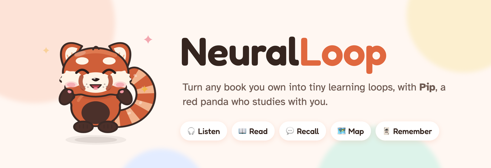
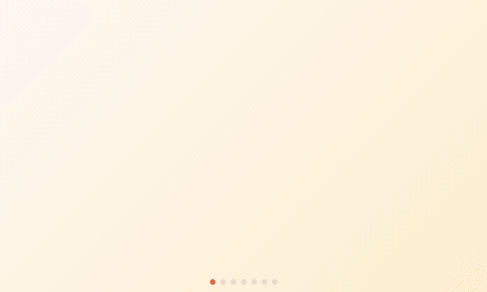
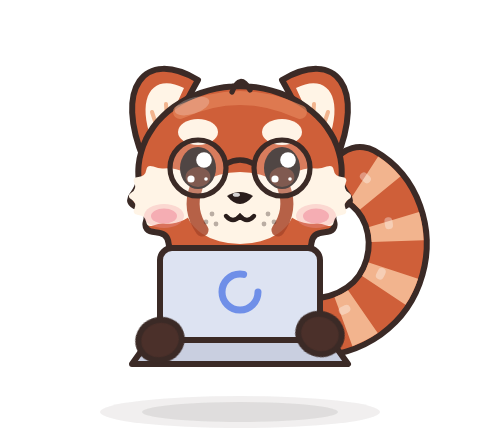
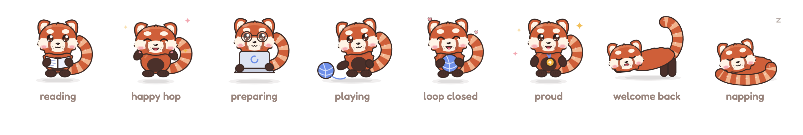

<p align="center">
  <picture>
    <source media="(prefers-color-scheme: dark)" srcset="docs/readme/hero-dark.png">
    
  </picture>
</p>

<p align="center">
  
  
  
  
</p>

<p align="center">
  <b>Drop in a PDF or EPUB. Pip turns every chapter into a five-step loop that actually makes it stick.</b><br>
  <sub>Podcasts · explainer videos · reading plans · recall checks · quizzes · mind maps · concept graphs · flashcards</sub>
</p>

<br>

<p align="center">
  
</p>

<p align="center"><sub>🐾 a little tour: drop a book → Pip prepares it → listen · read · recall · map · remember → watch your book map grow</sub></p>

<br>

## 🌸 How a loop works

Every chapter is one loop. Chapters open one at a time, so you really finish what you start.

<table>
  <tr>
    <td align="center" width="20%"><br><b>1 · Listen & watch</b></td>
    <td>A two-host podcast about the chapter and a short animated explainer. Hearing the ideas first makes the page feel familiar.</td>
  </tr>
  <tr>
    <td align="center"><br><b>2 · Read</b></td>
    <td>The chapter itself, like a textbook (figures, captions, lists), with a reading plan that says what to read closely and what to skim.</td>
  </tr>
  <tr>
    <td align="center"><br><b>3 · Recall</b></td>
    <td>Explain it in your own words; a small model checks each key point. Then a quiz with hints and explanations.</td>
  </tr>
  <tr>
    <td align="center"><br><b>4 · Map</b></td>
    <td>Remake the mind map from memory, then explore the concept graph: guided tour, "how are these connected?", rebuild from memory.</td>
  </tr>
  <tr>
    <td align="center"><br><b>5 · Remember</b></td>
    <td>Flashcards on a spaced-repetition schedule (FSRS) that bring each card back right before you'd forget it.</td>
  </tr>
</table>

Close a loop and the next chapter opens 🎉. Your **book map** sprouts with every chapter you map, and **Your year with Pip**
fills in a little square for every day you study.

## ✨ What makes it lovely

<table>
  <tr>
    <td width="33%" valign="top"><h3>🧠 Your AI, your choice</h3>Google NotebookLM by default. Or Claude, OpenAI, OpenRouter, a free local model (Ollama, LM Studio), opencode, or Hermes. If one can't make something, another steps in, and the book always finishes.</td>
    <td width="33%" valign="top"><h3>🔒 Private by design</h3>Your books stay on your Mac. Only the chapter being prepared goes to the AI you chose, and your library syncs to a hidden folder in <i>your own</i> Google Drive.</td>
    <td width="33%" valign="top"><h3>💻 Mac + iPad</h3>The Mac prepares books; the iPad picks up your library, progress, cards, and where you left off. Study offline once a chapter is open.</td>
  </tr>
  <tr>
    <td valign="top"><h3>🐾 Pip in your menu bar</h3>Pick up where you left off, play the podcast, see what's ready, and get at most one gentle nudge a day (never in quiet hours, never guilt).</td>
    <td valign="top"><h3>🎧 Voices on your Mac</h3>Podcasts and explainers are voiced on-device with Rumik, with a "fast" mode, and podcast length that fits the chapter.</td>
    <td valign="top"><h3>📦 Install once</h3>One download with the programs inside: no Python, no Docker, no terminal. Rumik's voices and local models download on first use.</td>
  </tr>
</table>

## 🐼 Meet Pip

<p align="center">
  
</p>

<p align="center"><sub>Pip reads with you, hops when you get it right, naps while it waits, and is <b>never</b> cross or disappointed. Stay away too long and Pip gets dramatic, just for laughs (a tiny sad violin 🎻, a sad song 😿, then a shocked “fahhh” after a whole day). Silly mode switches off in Settings.</sub></p>

## 🚀 Get it

**Mac** (Apple silicon, macOS 14 or later)

1. Download the `.dmg` from the [latest release](../../releases/latest).
2. Drag Pip into your Applications folder (the window shows you where 🐾).
3. Open NeuralLoop. The first time, macOS double-checks with you: **System Settings → Privacy & Security → Open Anyway**.
   After an update it may ask once to let NeuralLoop use its saved keys in your keychain: enter your password and
   click **Always Allow** ([why](SECURITY.md#how-the-mac-app-is-signed)).

<details>
<summary><b>iPad</b> (iPadOS 17 or later)</summary>

<br>

For now, the iPad app is built from this repo with Xcode (free Apple ID is fine). The steps are in
[docs/DEVELOPMENT.md → Installing on your iPad](docs/DEVELOPMENT.md#installing-on-your-ipad).

</details>

<details>
<summary><b>Build from source</b></summary>

<br>

```bash
make setup    # once: a .venv with hash-locked tools
make check    # every test and linter
make mac      # build and open the Mac app
```

[docs/ARCHITECTURE.md](docs/ARCHITECTURE.md) is a guided tour of the code, and [CLAUDE.md](CLAUDE.md) has the rules and
contracts. Contributions are welcome: see [CONTRIBUTING.md](CONTRIBUTING.md).

</details>

## 📜 Licensing

NeuralLoop is **source-available** under the [PolyForm Noncommercial License 1.0.0](LICENSE).

|   | |
|---|---|
| ✅ | Free for personal use, learning, research, teaching, and other non-commercial purposes |
| ❌ | Not for commercial use, resale, or offering it as a paid product or service without a commercial license |

The NeuralLoop name and Pip are brand assets, not covered by the software license ([TRADEMARKS.md](TRADEMARKS.md)).
Third-party parts keep their own licenses ([NOTICE.md](NOTICE.md)); the Rumik voices are non-commercial.

**Commercial licensing and partnerships:** open an issue titled "Commercial license", or reach out through
[github.com/NebulaTris](https://github.com/NebulaTris). Security reports: please use GitHub's private vulnerability
reporting ([SECURITY.md](SECURITY.md)).

<br>

<p align="center">
  <br>
  <sub>Made with care (and a lot of yarn) · <b>Learn it. Loop it.</b> 🐾</sub>
</p>
